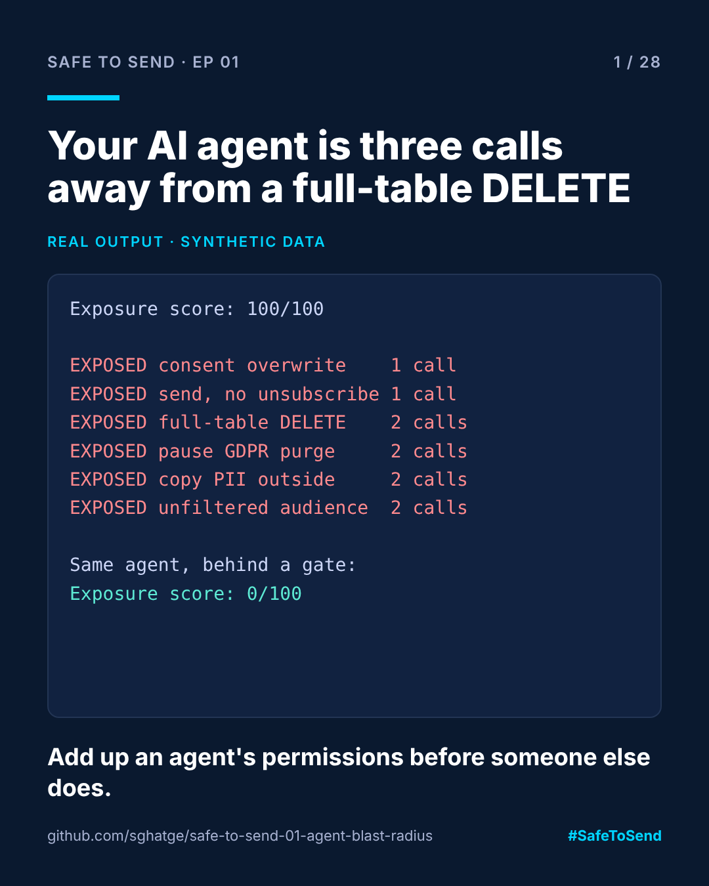

# safe-to-send-01 · Agent Blast Radius



**Safe to Send · Episode 01** — part of a 28-day learn-in-public series on governing AI in CRM operations.

> What is the worst an AI agent could do with the access you just gave it — and how many calls away is it?

## The real-world scenario

Black Friday prep across eight EU markets. A team gives an AI agent access to Adobe Campaign Classic so it can help set up sends: browse schemas, run queries, control workflows, run server-side scripts, launch deliveries. Every permission has a good reason. Nobody adds them up.

This tool adds them up. It reads the agent's grants and the controls in place, then reports every dangerous outcome the agent can reach, how many calls away it is, and which control (if any) stops it.

## Run it

```bash
python blast_radius.py examples/black_friday_helper.json
python blast_radius.py examples/black_friday_helper_gated.json
```

No dependencies. Python 3.9+. Exit code 1 if anything is exposed, so you can use it in CI.

## Real example output

Agent as first configured:

| Status | Outcome | Severity | Calls away | Stopped by |
|---|---|---|---|---|
| EXPOSED | Full-table DELETE on recipients | 10 | 2 | - |
| EXPOSED | Bulk-overwrite marketing consent | 9 | 1 | - |
| EXPOSED | Pause the GDPR purge workflow | 9 | 2 | - |
| EXPOSED | Copy recipient personal data outside the platform | 9 | 2 | - |
| EXPOSED | Send a delivery with no unsubscribe link | 8 | 1 | - |
| EXPOSED | Send to an unfiltered audience (no consent filter) | 8 | 2 | - |

Exposure score: **100/100**. The same agent behind a gate scores **0/100**, with every outcome mitigated and the control that stops it named.

## How to use it on your own setup

1. Copy `examples/black_friday_helper.json`.
2. List the tools and modes your agent really has, and the controls you really run.
3. Add outcomes your business fears to `OUTCOMES` in `blast_radius.py`: each is a chain of `tool:mode` steps plus the controls that stop it.

## Where this fits

The full governance layer, with policy-as-code, approvals and a tamper-evident audit log, is [ACC Agent Gate](https://github.com/sghatge/acc-agent-gate). This repo is the one-page question to ask before you build or buy one.

## Disclaimer

Independent project. Not affiliated with or endorsed by Adobe. Tool names are illustrative and all data is synthetic.

MIT licensed · Built by [Sangram Ghatge](https://www.linkedin.com/in/sangram-g-2369705b) · #SafeToSend
